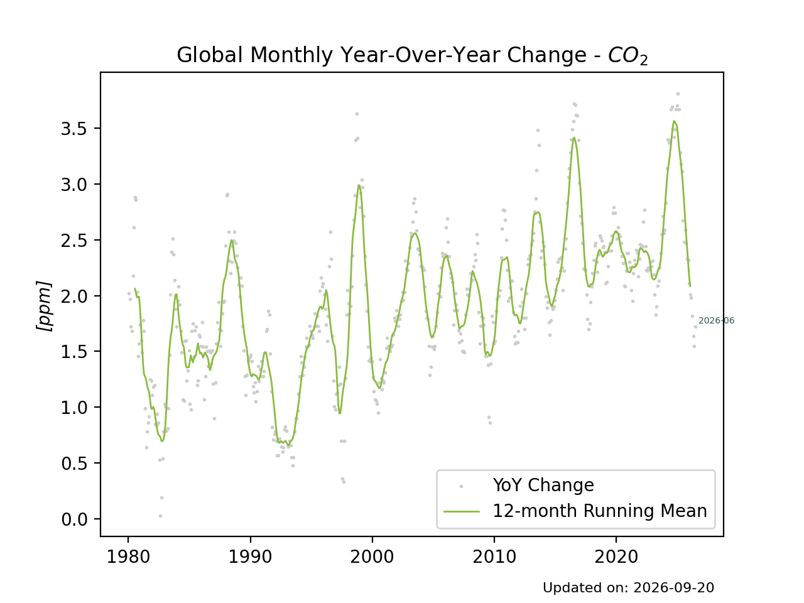
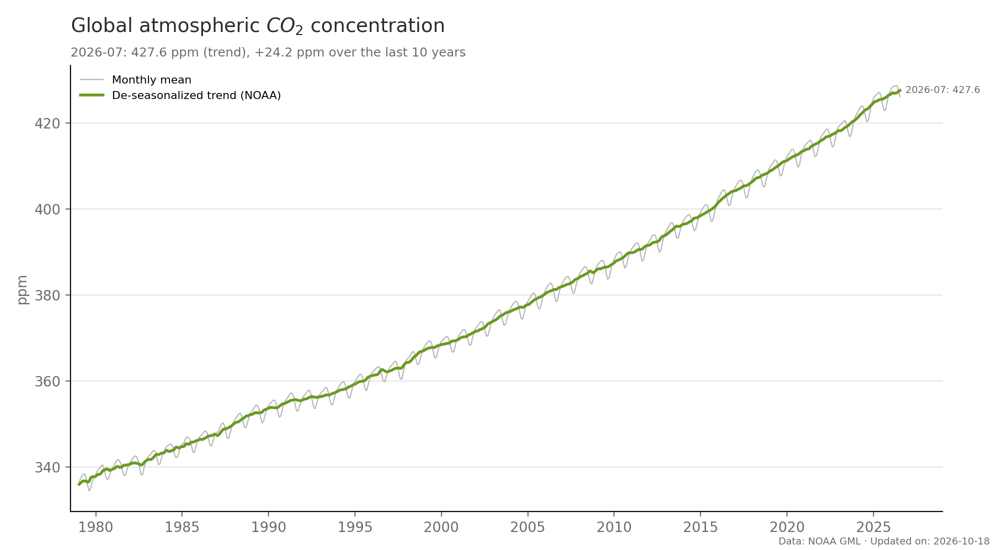
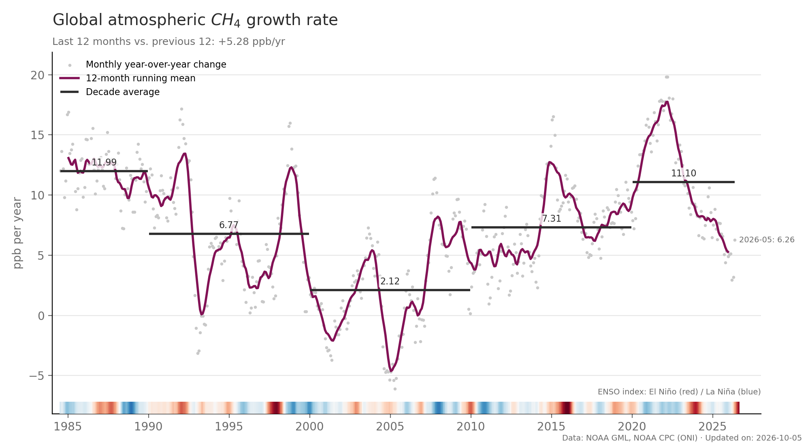
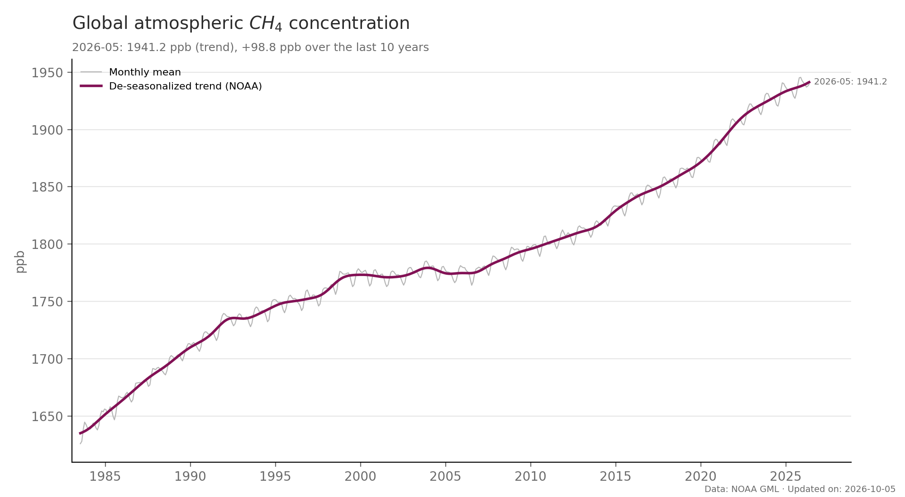
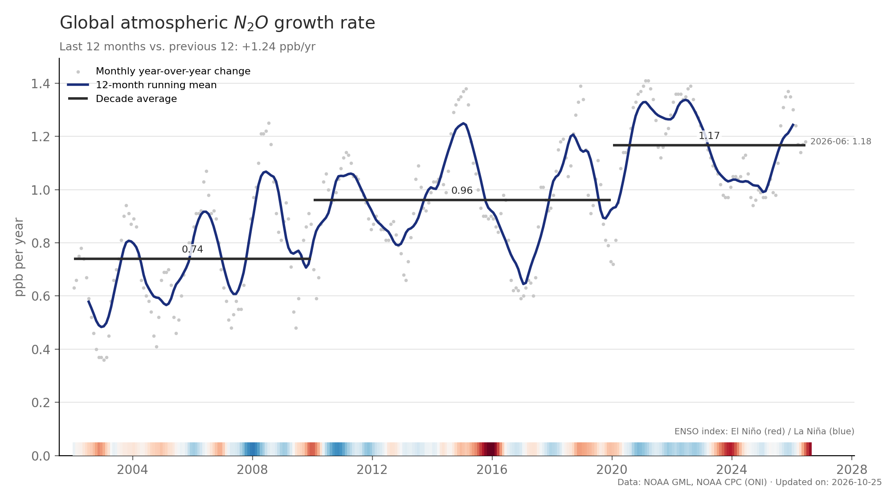
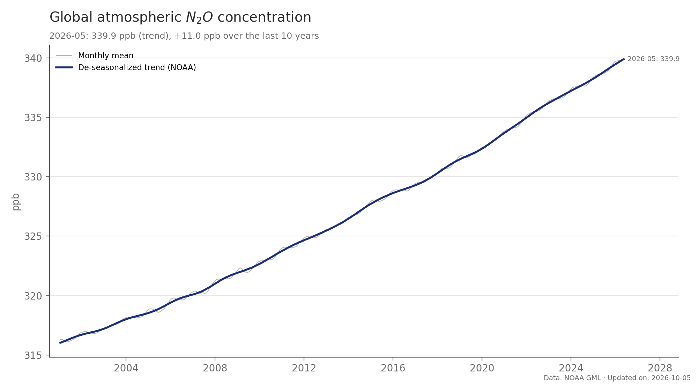
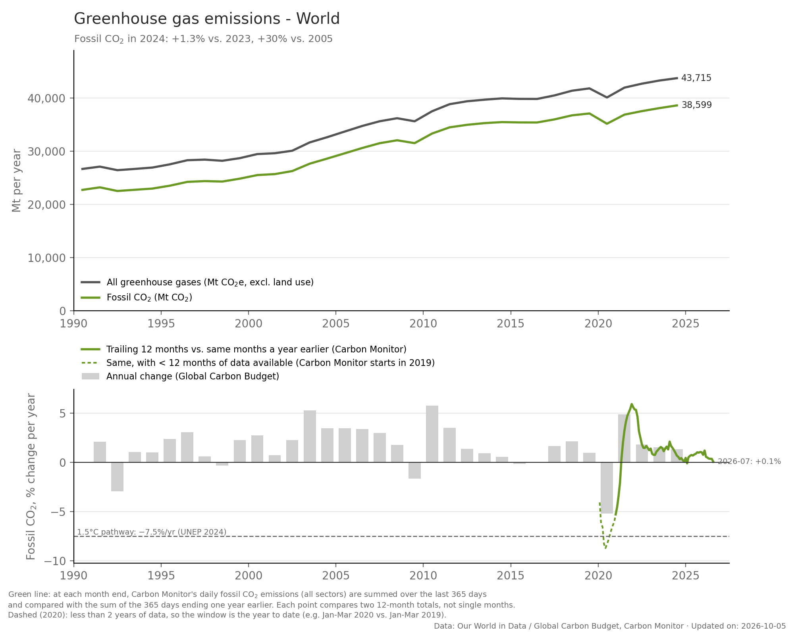
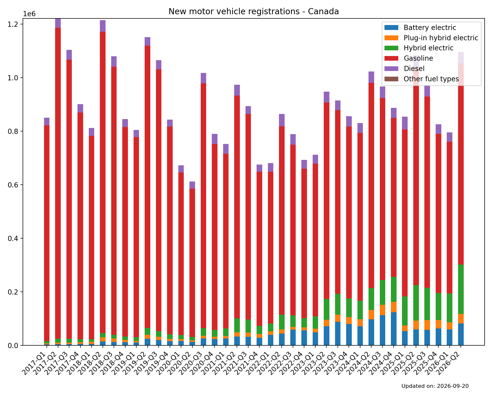
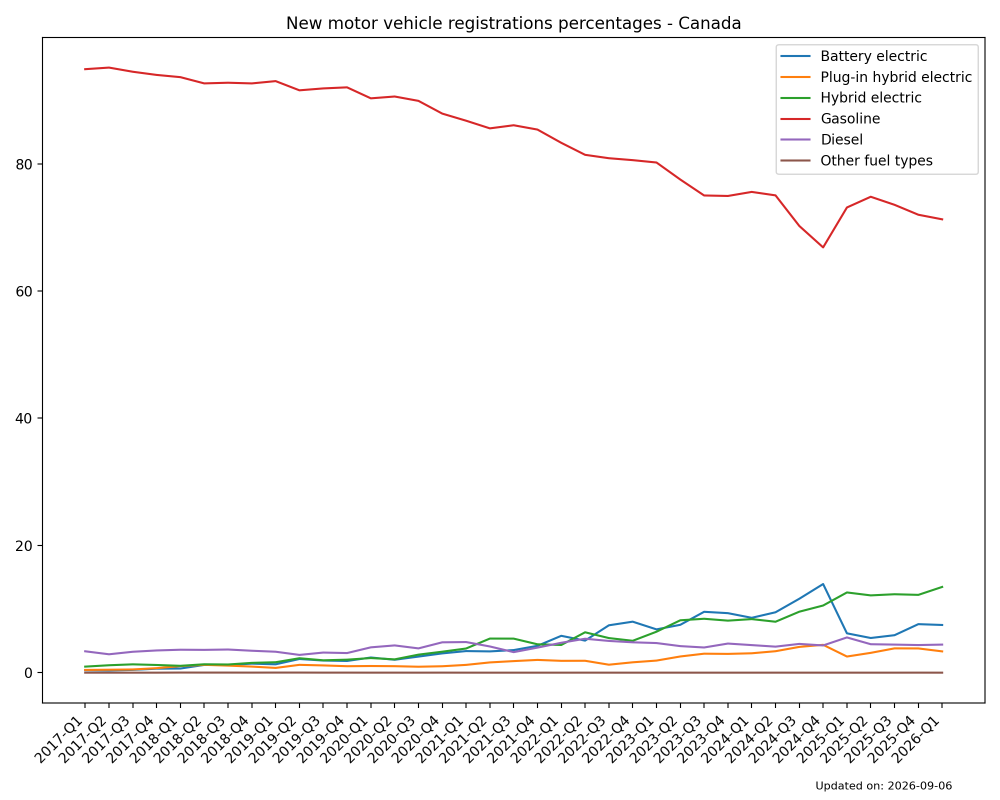
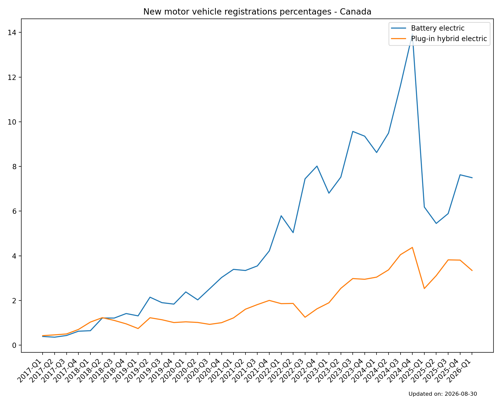

# transition-trends-canada

# Dev

`poetry run python make_ghg_plots.py`

`poetry run python make_emissions_plots.py`

`poetry run python make_ev_registration_plots.py`

# Global Greenhouse Gases

How fast is each gas accumulating in the atmosphere? Emission cuts show up here as a falling growth rate.
- Grey dots: change vs. the same month a year earlier (updated monthly, noisy).
- Coloured line: 12-month running mean of those dots.
- Black bars: average growth rate per decade, the long-term signal.
- Bottom strip: El Niño (red) / La Niña (blue). El Niño years raise CO2 growth for a few months to a year (less uptake by tropical forests, more fires), so spikes lined up with red are mostly natural, not emissions.

## CO2

## CH4

## N2O

# Greenhouse Gas Emissions

Emissions measured at the source rather than in the atmosphere.
- Top: yearly fossil CO2 and all greenhouse gases (CO2-equivalent, excluding land use), from the Global Carbon Budget via Our World in Data. Updated once a year, roughly 1-2 years behind.
- Bottom: yearly % change (bars), plus a monthly-updated trailing-12-month % change from Carbon Monitor (~2 months behind; not available for Canada). The dashed line is the ~7.5%/yr global cut needed for 1.5°C (UNEP Emissions Gap Report 2024).

## World

Per-country plots: [United States](plots/emissions/usa.png) · [China](plots/emissions/china.png) · [France](plots/emissions/france.png) · [Canada](plots/emissions/canada.png)

# Canadian New Vehicle Registrations

## Canada

